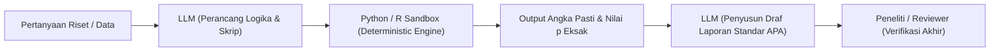
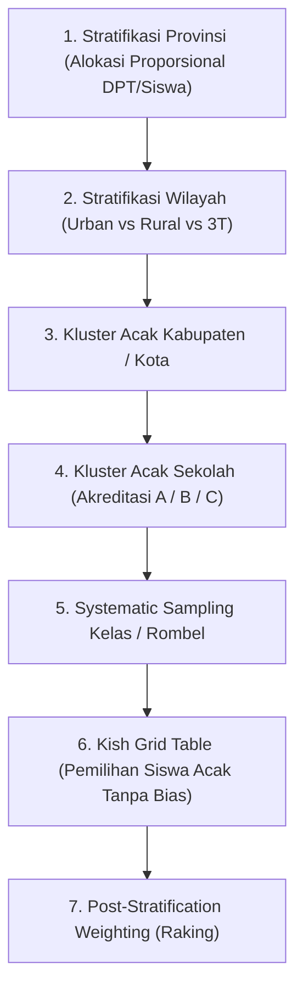
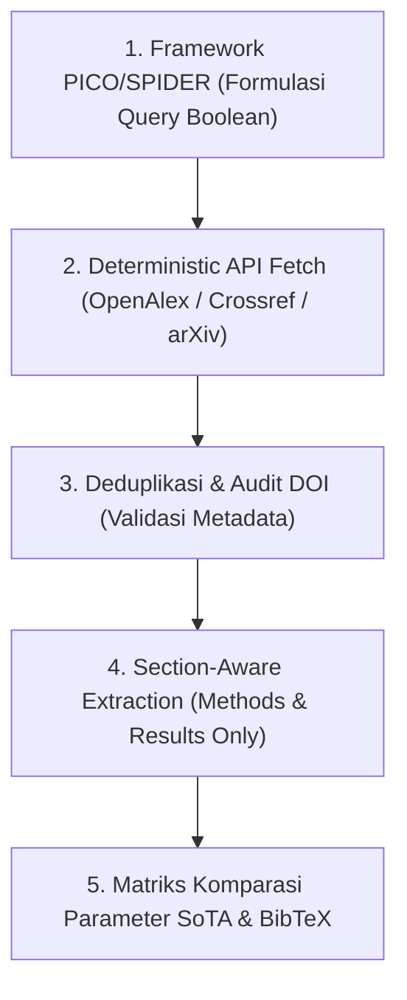
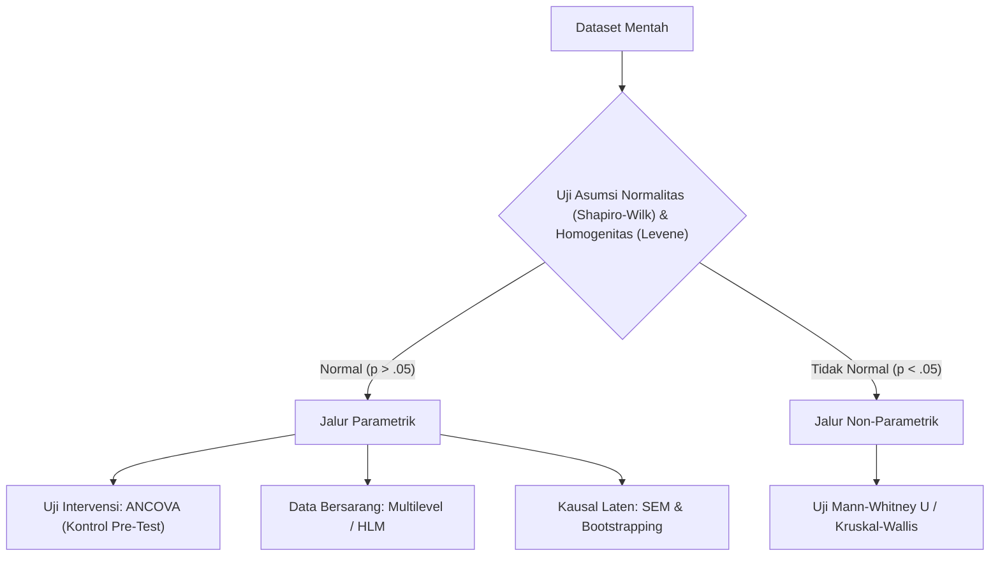
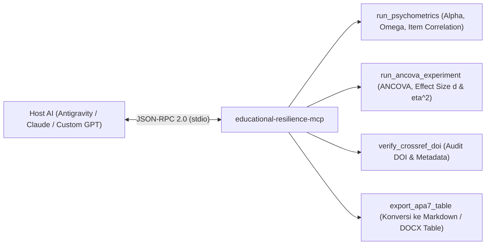

# AI-Assisted Educational Research & Resilience Analytics
## *Metodologi Presisi, Komputasi Deterministik, dan Eliminasi Halusinasi*

> **Draf Monograf & Panduan Komprehensif**  
> Didesain untuk: Tim Peneliti, Dosen, dan Civitas Akademika **PUI (*Pusat Unggulan Ipteks*) Educational Resilience**  
> Penulis: Peer Research & AI Engineering Team  

---

## DAFTAR ISI
1. [Bab 1: Paradigma Baru AI dalam Riset Pendidikan](#bab-1-paradigma-baru-ai-dalam-riset-pendidikan)
2. [Bab 2: Desain Sampling Presisi Tinggi: Pelajaran dari Survei Pemilu](#bab-2-desain-sampling-presisi-tinggi-pelajaran-dari-survei-pemilu)
3. [Bab 3: Tinjauan Pustaka Sistematis (SLR) & Sintesis SoTA Bebas Halusinasi](#bab-3-tinjauan-pustaka-sistematis-slr--sintesis-sota-bebas-halusinasi)
4. [Bab 4: Psikometri Modern & Kalibrasi Alat Ukur Resiliensi](#bab-4-psikometri-modern--kalibrasi-alat-ukur-resiliensi)
5. [Bab 5: Pipeline Analisis Data Kuantitatif Lanjutan: Eksperimen hingga SEM/HLM](#bab-5-pipeline-analisis-data-kuantitatif-lanjutan-eksperimen-hingga-semhlm)
6. [Bab 6: Arsitektur Ekstensibilitas: Implementasi Skill & Server MCP](#bab-6-arsitektur-ekstensibilitas-implementasi-skill--server-mcp)
7. [Lampiran: Skema Data Sintetis Survei Resiliensi (N=300)](#lampiran-skema-data-sintetis-survei-resiliensi-n300)

---

# Bab 1: Paradigma Baru AI dalam Riset Pendidikan

### 1.1 Anatomi Komputasi: Mengapa LLM Berhalusinasi pada Angka?
Large Language Model (LLM) pada dasarnya adalah mesin inferensi autoregresif. Operasi matematis utamanya adalah memprediksi probabilitas distribusi token berikutnya berdasarkan konteks sebelumnya:

$$P(w_t \mid w_1, w_2, \dots, w_{t-1})$$

LLM **bukan mesin hitung deterministik**. Ketika peneliti meminta LLM menghitung nilai korelasi Pearson ($r$), nilai $F$-hitung, atau mean data kuesioner secara langsung di kolom chat, model membangkitkan representasi tekstual yang tampak "masuk akal" secara sintaksis, namun sering kali sepenuhnya salah secara aritmatika (*mathematical hallucination*).

> [!CAUTION]
> Mengunggah raw data ke LLM publik dan meminta kesimpulan statistik langsung tanpa eksekusi kode adalah pelanggaran kaidah ilmiah (*methodological misconduct*) karena hasilnya tidak dapat direplikasi (*reproducibility failure*).

### 1.2 Paradigma "Program-Aided LLM" (Pemisahan Peran)
Solusi baku dalam integritas sains modern adalah memisahkan tugas secara tegas:
* **LLM sebagai *Architect of Logic*:** Membantu peneliti membedah pertanyaan riset, memilih uji statistik yang sahih, menyusun skrip kode, dan menginterpretasikan output matematis.
* **Deterministic Execution Engine (Python/R):** Mengeksekusi komputasi numerik secara terisolasi menggunakan pustaka terverifikasi (`scipy`, `statsmodels`, `pingouin`, `lavaan`).



---

# Bab 2: Desain Sampling Presisi Tinggi: Pelajaran dari Survei Pemilu

### 2.1 Mengapa Ukuran Populasi ($N$) Menjadi Tidak Relevan?
Kritik umum masyarakat awam: *"Bagaimana mungkin 2.000 sampel responden bisa mewakili 205 juta pemilih Indonesia?"*

Secara fisika dan matematika statistik, Teorema Limit Pusat (*Central Limit Theorem*) membuktikan bahwa variansi sampel proporsi dirumuskan:

$$SE = \sqrt{\frac{p(1-p)}{n}} \times \sqrt{\frac{N-n}{N-1}}$$

Ketika populasi $N$ sangat masif ($N \to \infty$), faktor koreksi populasi berhingga (*Finite Population Correction*):

$$\lim_{N \to \infty} \sqrt{\frac{N-n}{N-1}} = 1$$

Pada tingkat kepercayaan 95% ($Z = 1.96$) dengan variansi konservatif maksimum ($p = 0.5$):

$$MoE \approx 1.96 \times \sqrt{\frac{0.5 \times 0.5}{n}} = \frac{0.98}{\sqrt{n}}$$

| Ukuran Sampel ($n$) | Margin of Error ($MoE$) pada 95% CI | Relevansi dalam Riset Pendidikan |
| :---: | :---: | :--- |
| **100** | $\pm 9.80\%$ | Uji coba instrumen awal / *pilot study*. |
| **300** | $\pm 5.65\%$ | Batas minimum analisis faktor (CFA/EFA) rasio $10:1$. |
| **1.200** | $\pm 2.83\%$ | Standar survei pemilu nasional / evaluasi kebijakan daerah. |
| **2.400** | $\pm 2.00\%$ | Riset evaluasi skala nasional (Kemendikbud/Bappenas). |

### 2.2 Anatomi Protokol: Multistage Stratified Systematic Random Sampling
Agar data mewakili populasi tanpa bias seleksi (*selection bias*), desain sampling mengikuti 7 tahapan eliminasi bias:



> [!IMPORTANT]
> **Kritik terhadap Riset Pendidikan Konvensional:**  
> Peneliti sering terjebak pada *Convenience Sampling* (hanya meneliti sekolah di pusat kota atau sekolah kenalan). Data yang dihasilkan menderita *severe sampling bias* sehingga kebijakan resiliensi yang dirumuskan tidak adaptif bagi sekolah marjinal/3T.

---

# Bab 3: Tinjauan Pustaka Sistematis (SLR) & Sintesis SoTA Bebas Halusinasi

### 3.1 Protokol PRISMA Terotomasi
Penyusunan State-of-the-Art (SoTA) dilakukan melalui protokol PRISMA (*Preferred Reporting Items for Systematic Reviews and Meta-Analyses*) dengan gerbang verifikasi deterministik:



### 3.2 Formulasi Query Berbasis PICO
* **Population ($P$):** `("high school students" OR "adolescents" OR "siswa SMA")`
* **Intervention ($I$):** `("resilience training" OR "growth mindset intervention" OR "social-emotional learning")`
* **Comparison ($C$):** `("control group" OR "conventional teaching" OR "placebo")`
* **Outcome ($O$):** `("CD-RISC" OR "academic buoyancy" OR "burnout reduction")`

### 3.3 Format Matriks State-of-the-Art (Output Standar)

| Penulis & Tahun | DOI Terverifikasi | Desain & Sampel ($N$) | Instrumen Ukur | Nilai Efek (*Effect Size*) | Research Gap / Keterbatasan |
| :--- | :--- | :--- | :--- | :--- | :--- |
| Smith et al. (2023) | `10.1016/j.cedpsych.2023.1021` | Eksperimen Murni ($N=240$, Urban) | BRS (6 butir) | Cohen's $d = 0.65$ | Belum menguji efek longitudinal pasca-3 bulan. |
| Rahmawati & Lee (2024) | `10.1080/00220973.2024.2312` | Korelasional Multilevel ($N=1.100$, 3T) | CD-RISC 10 | $\beta = 0.42, p < .001$ | Mengabaikan faktor stres guru sebagai kovariat. |

---

# Bab 4: Psikometri Modern & Kalibrasi Alat Ukur Resiliensi

### 4.1 Teori Klasik (CTT) vs Teori Respon Butir (IRT)
* **Classical Test Theory (CTT):** Menghitung total skor mentah $X = T + E$. Rentan bias karena skor siswa tergantung pada sulit/mudahnya butir soal tertentu.
* **Item Response Theory (IRT / Rasch):** Memodelkan probabilitas siswa menjawab butir pada skala logit invarian:

$$P(Y_{ni} = 1 \mid \theta_n, \beta_i) = \frac{e^{(\theta_n - \beta_i)}}{1 + e^{(\theta_n - \beta_i)}}$$

Di mana $\theta_n$ adalah trait ketahanan sejati siswa, dan $\beta_i$ adalah bobot kesulitan butir.

### 4.2 Prosedur Evaluasi Kelayakan Skala Likert
1. **Reverse-Scoring Butir Negatif:**  
   Butir pernyataan negatif (misal: *"Saya merasa tidak berdaya saat ujian sulit"*) wajib dibalik sebelum dijumlahkan:
   $$X_{\text{rev}} = (k + 1) - X_{\text{raw}}$$
   (Untuk skala Likert 1–5, $X_{\text{rev}} = 6 - X$).
2. **Uji Reliabilitas Konsistensi Internal:**
   * **Cronbach's Alpha ($\alpha$):** Standar minimum riset lapangan $\alpha \ge 0.70$.
   * **McDonald's Omega ($\omega$):** Lebih tahan terhadap pelanggaran asumsi tau-ekuivalen.
3. **Analisis Validitas Konstruk (CFA):**
   * *Factor Loading* ($\lambda_i$) $\ge 0.50$ per butir.
   * *Average Variance Extracted* ($AVE$) $\ge 0.50$.
   * *Composite Reliability* ($CR$) $\ge 0.70$.

---

# Bab 5: Pipeline Analisis Data Kuantitatif Lanjutan



### 5.1 One-Way ANCOVA (Analisis Kovariansi Eksperimen)
Ketika menguji efektivitas modul resiliensi antara kelas Eksperimen dan Kontrol, kemampuan awal siswa (*Pre-test*) wajib diperlakukan sebagai **Kovariat** ($X$):

$$Y_{ij} = \mu + \tau_i + \beta(X_{ij} - \bar{X}_{\bullet\bullet}) + \epsilon_{ij}$$

* Keunggulan: Menghilangkan variansi kesalahan yang disebabkan oleh perbedaan awal siswa, sehingga lonjakan skor *Post-test* murni berasal dari intervensi perlakuan ($\tau_i$).

### 5.2 Pemodelan Kausal SEM (*Structural Equation Modeling*)
Menguji transmisi kausal tidak langsung (*indirect effect* / mediasi):
* **Indeks Keselarasan Model (*Goodness-of-Fit*):**
  * $\chi^2 / df < 3.0$
  * $CFI \ge 0.95$ dan $TLI \ge 0.95$
  * $RMSEA < 0.06$ (dengan 90% CI $< 0.08$)
  * $SRMR < 0.08$
* **Bootstrapping Non-Parametrik (5.000 sampel):** Menilai signifikansi efek mediasi melalui interval kepercayaan 95% bias-corrected. Jika rentang CI tidak melewati angka $0$, efek mediasi dinyatakan signifikan secara definitif.

---

# Bab 6: Arsitektur Ekstensibilitas: Implementasi Skill & Server MCP

### 6.1 Desain Arsitektur Server MCP (`educational-resilience-mcp`)
Server MCP bekerja sebagai daemon lokal berbasis Python (`FastMCP`) yang mengekspos 4 fungsi deterministik melalui protokol IPC `stdio`:



### 6.2 Integrasi Skill Lintas Platform
Protokol instruksi dapat dipasang langsung pada:
* **Antigravity:** Sebagai direktori `.agents/skills/educational-resilience/SKILL.md`.
* **Claude Desktop:** Ditautkan via file `claude_desktop_config.json` mengarah ke server Python.
* **ChatGPT (Custom GPT):** Ditanamkan pada *System Instructions* dengan memanfaatkan fitur *Code Interpreter* Python bawaan.

---

# Lampiran: Skema Data Sintetis Survei Resiliensi ($N=300$)

Dataset latihan dirancang dengan skema relasional berikut:

```
[ Tabel: data_survei_resiliensi_300.csv ]
├── ID_Siswa         : [RES_001 s.d. RES_300] (Identifier)
├── Gender           : [L, P]
├── Zona_Sekolah     : [Urban, Rural, 3T]
├── Tingkat_Kelas    : [10, 11, 12]
├── Kelompok         : [Eksperimen, Kontrol]
├── Pre_Test_Akademik: [Float, Skala 0-100]
├── Post_Test_Akademik: [Float, Skala 0-100]
├── DG1 s.d. DG6     : [Integer 1-5, Dukungan Guru & Sekolah]
├── ED1 s.d. ED6     : [Integer 1-5, Efikasi Diri Akademik]
└── RES1 s.d. RES8   : [Integer 1-5, Resiliensi Belajar]
                       *Catatan: RES4 dan RES7 adalah butir negatif (reverse-coded).
```

---
*Dokumen ini dirancang sebagai master framework untuk materi pelatihan PUI Educational Resilience dan siap dikembangkan lebih lanjut menjadi modul diktat riset.*

